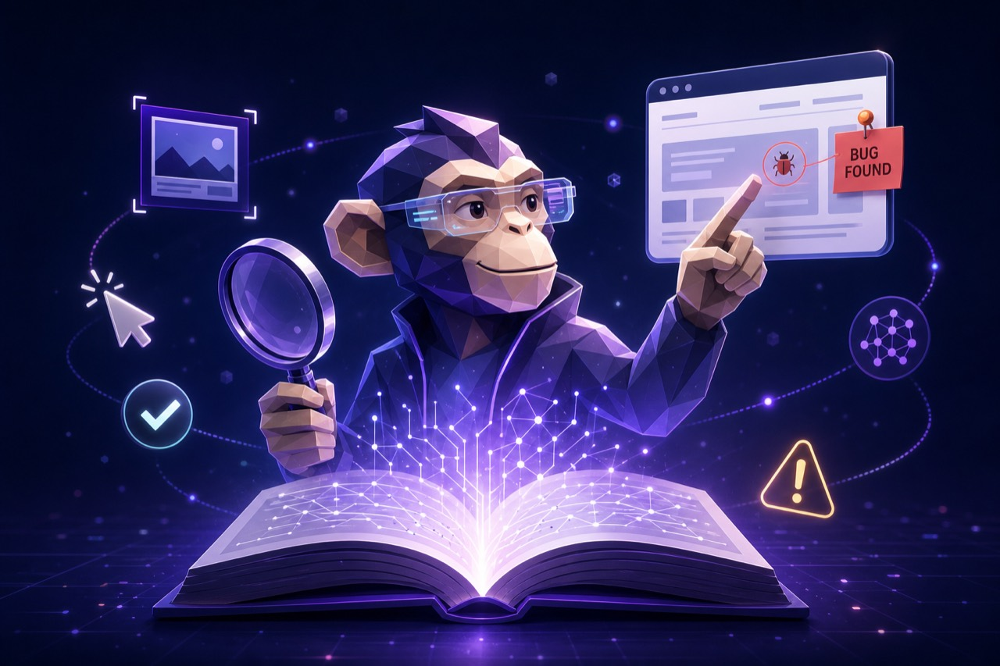

<p align="center">
  
</p>

<h1 align="center">monkeytester</h1>

<p align="center">
  <strong>An AI agent that uses your site like a real user — and reports the bugs.</strong><br />
  Open source. Playwright + your favourite LLM. First result in about a minute, no API key.
</p>

<p align="center">
  <a href="https://www.npmjs.com/package/@monkeytestai/monkeytester"></a>
  <a href="https://nodejs.org/"></a>
  <a href="https://docs.monkeytest.ai"></a>
  <a href="https://github.com/monkeytestai/monkeytester/actions/workflows/ci.yml"></a>
  <a href="https://github.com/monkeytestai/monkeytester/blob/main/LICENSE"></a>
</p>

<p align="center">
  <a href="https://docs.monkeytest.ai/guide/quick-start">Quick start</a> ·
  <a href="https://docs.monkeytest.ai/guide/why-monkeytest">Why monkeytest</a> ·
  <a href="https://docs.monkeytest.ai/guide/llm-providers">LLM providers</a> ·
  <a href="https://docs.monkeytest.ai/guide/cost-and-depth">Cost & depth</a> ·
  <a href="https://docs.monkeytest.ai/reference/overview">API</a> ·
  <a href="https://monkeytest.ai">Cloud</a>
</p>

---

Most "AI testing" tools stop at *finding* bugs. monkeytester is built around the **full loop**:

> **find → fix → re-run the same plan → diff what changed.**

Point it at a URL. It crawls a few pages, asks an LLM *"what would a real user try here?"*, runs those flows step by step, and writes a stable, versioned `plan.json` you can commit to git. Tomorrow, after you ship a fix, **`monkeytest rerun`** re-executes the *exact same* plan — no LLM cost for re-planning, no plan drift between runs — and **`monkeytest diff`** tells you what's new, what's fixed, what regressed.

```bash
npx monkeytest run https://example.com   # first run: explore + plan + execute, exit 1 if bugs
# ...you ship a fix...
npx monkeytest rerun                     # re-runs the same plan, exit 1 if any blocking bug remains
npx monkeytest diff prev latest          # 2 fixed, 0 new, 1 still broken, 0 regressed (net -2)
```

Those subcommands come from `npm install @monkeytestai/monkeytester`. A clone runs them with `node dist/cli.js`.

Or programmatically — same primitives:

```ts
import { Monkey, autoLLMConfig, savePlan, loadPlan, diffRuns, saveRun } from '@monkeytestai/monkeytester';

const monkey = new Monkey({ llm: autoLLMConfig({ quality: 'balanced' }) });

// Day 1 — discover
const { plan, run: a } = await monkey.executeAndTriage('https://example.com', {
  run: { screenshotsDir: '.monkeytest/shots' },
});
savePlan(plan, { dir: '.monkeytest' });
saveRun(a, { dir: '.monkeytest' });

// Day 2 — verify after fixing
const stored = loadPlan('.monkeytest');
const { run: b } = await monkey.runFromPlan(stored.plan, {
  run: { screenshotsDir: '.monkeytest/shots' },
});
saveRun(b, { dir: '.monkeytest' });

const diff = diffRuns(a, b);
console.log(`${diff.stats.fixed} fixed, ${diff.stats.regressed} regressed`);
```

No fixtures, no page objects, no recorders. Read [the bug-finding loop](https://docs.monkeytest.ai/guide/the-bug-finding-loop) for the full story. The import above resolves from [`@monkeytestai/monkeytester`](https://www.npmjs.com/package/@monkeytestai/monkeytester) on npm. See [why monkeytest](https://docs.monkeytest.ai/guide/why-monkeytest) for how it sits next to similar tools.

## Install

Node.js 20 or newer.

```bash
npm install @monkeytestai/monkeytester
npx playwright install chromium
```

[@monkeytestai/monkeytester](https://www.npmjs.com/package/@monkeytestai/monkeytester) **0.6.0** is the published package. The CLI is `npx monkeytest`.

```bash
export GEMINI_API_KEY="paste-your-key"
npx monkeytest run https://example.com --depth basic
```

`--depth basic` is the free **Quick pass**: at most 6 pages and 4 flows, biased toward forms, search, and primary buttons. `standard` and `deep` are the broader presets. `--max` and `--flows` still override the preset.

A finished run includes:

| Field | Values |
| ----- | ------ |
| `outcome` | `bugs_found`, `clean`, `inconclusive`, `could_not_test` |
| `outcome_reason` | Short code such as `automation_error`, `all_flows_skipped`, `site_unreachable`, `login_required` (only when a login wall was seen) |
| `outcome_detail` | A sentence that matches the confirmed bug count, plus a next step |

`could_not_test` means nothing was tested. Playwright errors from the runner are `inconclusive`, not bugs. Map these three fields straight onto `audit_run`.

Screenshots are written to `.monkeytest/shots/`. A free Gemini key, or Ollama on localhost, is in the [quick start](https://docs.monkeytest.ai/guide/quick-start), including where `plan.json`, `runs/`, and `shots/` show up, and how `rerun` / `diff` work.

### From a clone (contributors)

The no-key smoke script lives in the repository. It stubs the LLM, crawls `https://example.com`, and prints `OK — engine pipeline is wired correctly.`

```bash
git clone https://github.com/monkeytestai/monkeytester.git && cd monkeytester
npm install && npm run build
npx playwright install chromium && node scripts/smoke.mjs
```

`npm run build` writes `dist/cli.js`. The same subcommands are `node dist/cli.js run ...`.

## Docker

A multi-stage image compiles this package and leaves it at `/opt/monkeytester` (`dist/`, `package.json`, and production dependencies) so another image can copy it, or so a sibling checkout can satisfy `file:../monkeytester`. `mtaiserver` still uses `file:../monkeytest-core` until that repo is updated. API keys and Playwright browsers are not in the image. Build, the sibling layout, and the pinned hosted SHA are in [DOCKER.md](./DOCKER.md).

```bash
docker build -t monkeytester:local .
docker run --rm monkeytester:local --help
```

## Why monkeytester?

- **Closed loop, not just discovery.** Stable JSON plans + bug fingerprints + a real `rerun` and `diff` — built in, not bolted on.
- **Drop-in, not framework.** One library, one constructor. No DSL.
- **Bring your own LLM.** OpenAI, Gemini, Anthropic, Mistral, Groq, or any OpenAI-compatible endpoint (Ollama, vLLM, OpenRouter). Pick a different model **per phase**.
- **Real evidence.** Per-step screenshots, optional WebM video, console + network failures, and bug reports with stable fingerprints across runs.
- **Live activity stream.** Subscribe to a typed `EventBus` and pipe explorer / planner / runner / triager events into your own dashboard.
- **Resilient.** If the planner fails, you still get explorer screenshots. If a flow blows up, you still get the steps that ran. Nothing is all-or-nothing.
- **Hackable, typed, observable.** Pure TypeScript, zod-validated LLM output, structured `RunResult` you can serialise.

## A comprehensive example

```ts
import { Monkey, EventBus } from '@monkeytestai/monkeytester';

const events = new EventBus();
events.on(e => console.log(`[${e.phase}] ${e.type}: ${e.message}`));

// Mix providers per phase: cheap explorer + smart planner + fast runner
const monkey = new Monkey({
  llm: {
    explorer: { provider: 'gemini',    model: 'gemini-flash-lite-latest' },
    planner:  { provider: 'anthropic', model: 'claude-sonnet-4-5' },
    runner:   { provider: 'groq',      model: 'llama-3.3-70b-versatile' },
  },
});

const { siteMap, plan, run } = await monkey.executeAndTriage('https://app.example.com', {
  events,
  explore: { maxPages: 12, screenshotsDir: '.monkeytest/shots' },
  plan:    { maxFlows: 6, includeAuthFlows: false },
  run:     { screenshotsDir: '.monkeytest/shots', headless: true, stepTimeoutMs: 20_000 },
});

console.log(`Visited ${siteMap.pages.length} pages, planned ${plan.flows.length} flows.`);
console.log(`${run.outcome}: ${run.outcome_detail}`);

for (const bug of run.bugs.filter(b => b.severity !== 'minor')){
  console.error(`- [${bug.severity}] ${bug.title}\n  ${bug.observed}`);
  console.error(`  evidence: ${bug.evidence.screenshots.length} screenshot(s)`);
}
```

## Where it shines

- **Pre-release sanity checks** on staging.
- **PR previews** — run on Vercel/Netlify preview URLs in CI ([recipe](https://docs.monkeytest.ai/guide/ci)).
- **Daily smoke runs** against prod with cheap models.
- **Embedding in your own product** — the engine is a library, not a CLI.

## What it isn't

- Not a replacement for **deterministic critical-path E2E tests** — it's a complement.
- Not a **load tester** or **a11y auditor**.
- Not magic — quality of bug reports tracks the quality of the LLM you give it.

## Documentation

Everything lives at **[docs.monkeytest.ai](https://docs.monkeytest.ai)**:

- [Quick start](https://docs.monkeytest.ai/guide/quick-start) — npm install, or a clone for the no-key smoke run, then Gemini or Ollama
- [Why monkeytest](https://docs.monkeytest.ai/guide/why-monkeytest) — how it compares with nearby tools
- [The bug-finding loop](https://docs.monkeytest.ai/guide/the-bug-finding-loop) — explore once, run repeatedly, diff
- [CLI reference](https://docs.monkeytest.ai/reference/cli) — every subcommand and flag
- [How it works](https://docs.monkeytest.ai/guide/architecture) — the four phases
- [LLM providers](https://docs.monkeytest.ai/guide/llm-providers) — model picks per provider
- [Cost & depth](https://docs.monkeytest.ai/guide/cost-and-depth) — what each run costs
- [Recipes](https://docs.monkeytest.ai/guide/recipes) — battle-tested patterns
- [Use in CI](https://docs.monkeytest.ai/guide/ci) — GitHub Actions setup
- [Troubleshooting](https://docs.monkeytest.ai/guide/troubleshooting) — common errors

## MonkeyTest Cloud

Don't want to run it yourself? **[MonkeyTest Cloud](https://monkeytest.ai)** is the same engine, fully managed: hosted browsers, history, dashboards, team accounts.

## Contributing

PRs and issues welcome. See [CONTRIBUTING.md](./CONTRIBUTING.md) and [CODE_OF_CONDUCT.md](./CODE_OF_CONDUCT.md).

## Security

Report vulnerabilities privately — see [SECURITY.md](./SECURITY.md).

---

<sub>AGPL-3.0 · `SPDX-License-Identifier: AGPL-3.0-only` · See [LICENSE](./LICENSE) for the full text and the [license summary](https://docs.monkeytest.ai/guide/license).</sub>
